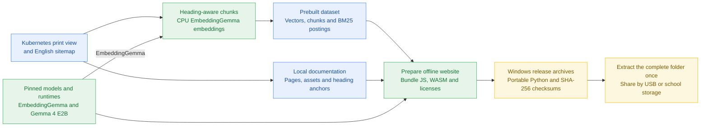
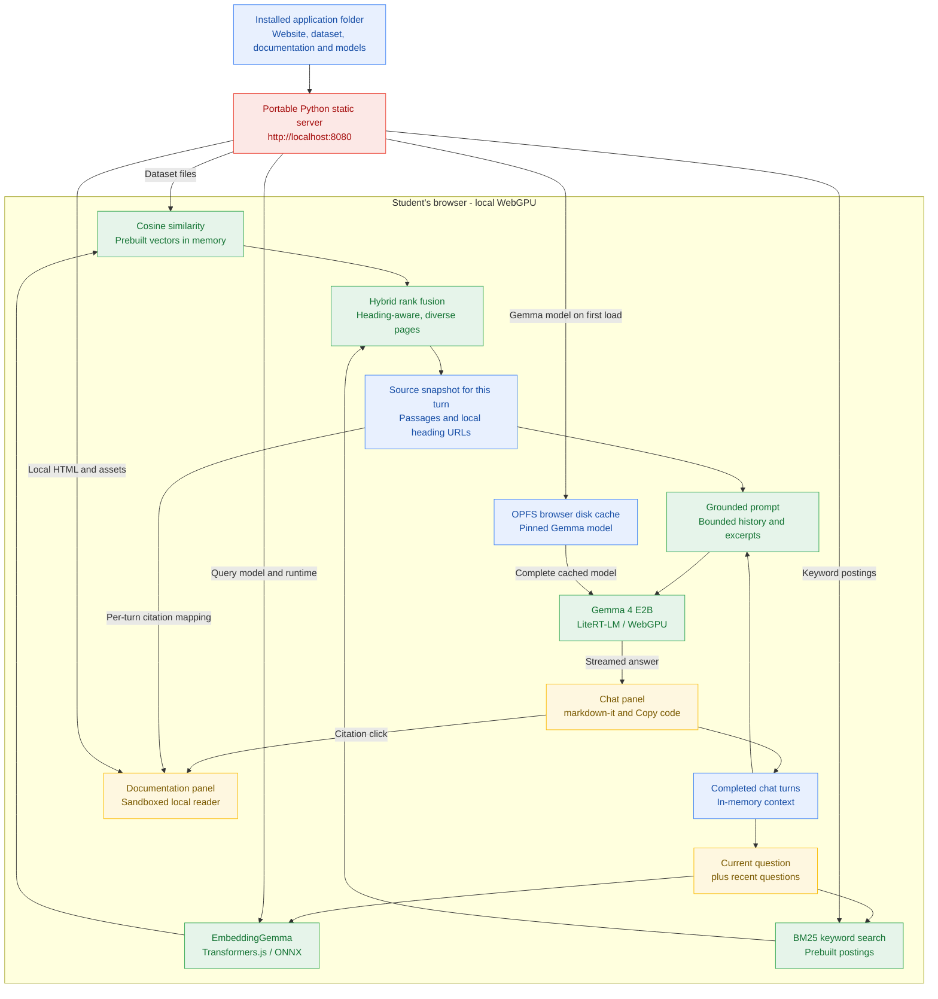

# Kubernetes WebAI RAG

Offline Kubernetes documentation search and answers, powered by **Gemma 4 E2B,
LiteRT-LM and WebGPU**, entirely in the browser. Designed for Windows 11 student
computers with a localhost web server and no internet during use.

This application is derived from [Jason Mayes' VectorSearch.js](https://github.com/jasonmayes/VectorSearch.js).
It retains his retrieval core and attribution, but adds a prebuilt Kubernetes
corpus, hybrid ranking, local documentation, cited answers and persistent model
caching. It is not the upstream library's general-purpose demo.

## Windows 11: student installation

**A Git clone or GitHub "Source code" ZIP is not the student installation.**
It does not include portable Python, the prepared documentation index or model
weights. `windows/Start-RAG.cmd` in the source tree is a packaging input, not a
ready-to-run application.

1. Download a fresh [Setup-RAG.cmd](https://github.com/wongcyrus/kubernetes-webai-rag/releases/download/v0.2.0/Setup-RAG.cmd)
   from the [v0.2.0 release](https://github.com/wongcyrus/kubernetes-webai-rag/releases/tag/v0.2.0).
   Save it in a separate installation folder, for example `D:\working\rag-install`.
2. Run `Setup-RAG.cmd` **before the exam**, with internet access. It downloads both
   release archives, verifies their SHA-256 checksums and extracts them. Wait for
   the `Ready` message; do not run the source-tree launcher instead.
3. Double-click `D:\working\rag-install\kubernetes-webai-rag\Start-RAG.cmd`.
   In this installed folder, `runtime\python.exe`, `serve.py` and `app\` must also
   exist.

For manual installation, download `kubernetes-webai-rag-0.2.0-windows-x64-app.zip`
and `kubernetes-webai-rag-0.2.0-windows-x64-model.zip` from the release assets.
Fully extract **both** into the same parent directory so their
`kubernetes-webai-rag/` folders merge. Do not choose the "Source code" downloads
or run the launcher directly inside a ZIP.

**Updating from v0.1.0:** stop the server with Ctrl+C and close the browser tab
before replacing files. The old `Setup-RAG.cmd` is pinned to v0.1.0: deleting the
installed folder and rerunning that script reinstalls the old UI. Download the
fresh v0.2.0 installer above and check that its window says `v0.2.0 setup`.
Run it in the same parent directory; a checksum-matching model ZIP in `.downloads`
is reused even if its filename belongs to an older version.

If the installed models are still present, you can instead extract only the new
application ZIP into the existing parent directory. The Gemma model is unchanged;
do not delete the installed folder or download the model again just to update the
UI. Start the server again and reload the page.

The release application archive includes the unmodified Windows x64 embeddable
Python runtime. Its launcher serves `app/` on `127.0.0.1:8080` and opens:

**http://localhost:8080/kubernetes.html**

Allow approximately **8 GiB of free disk space** for the downloaded archives,
extracted website/runtime and browser model cache. The online setup script
requires public release assets; for a private repository, distribute the two
archives directly and extract them manually.

Keep the server window open; Ctrl+C stops it. Python installation, npm, HTTPS
certificates and insecure-origin flags are not needed. If port 8080 belongs to
another application, the launcher reports the conflict instead of silently
changing the origin and losing access to the browser's model cache.

Use an up-to-date Chrome or compatible Chromium browser with **hardware WebGPU**.
Check `chrome://gpu`: a software adapter such as SwiftShader can be far too slow
for full prompts. HTTPS or localhost enables the API but cannot provide a missing
GPU. Windows ARM64 is not the packaged target. Institutional execution policies
may require IT approval of the downloaded launcher/runtime.

Before the exam, generate a complete answer, follow a citation, refresh and check
the cached model, then repeat with internet disconnected. Keep the tab open to
retain the loaded GPU engine. Native Windows GPU/launcher acceptance testing is
required before treating a release as exam-ready.

## Architecture design

The application has two separate phases: **prepare once on the maintainer's
computer**, then **run independently on every student's computer**. Python only
serves local files; retrieval and answer generation run in the student's browser.
There is no cloud inference service or shared AI backend.

**Version note:** use v0.2.0 for the two-panel chat, Markdown rendering and Copy
code features. The v0.1.0 installers and archives contain the old single-question
UI and remain pinned to that version. Updating source does not update an existing
Windows installation.

### 1. Offline preparation and distribution



[`scripts/build-kubernetes.mjs`](scripts/build-kubernetes.mjs) creates the corpus
once: **16,483 chunks with 768-dimensional normalized float32 vectors**, plus
keyword postings and canonical source anchors. It supports checkpoints and
resume. [`scripts/prepare-offline.mjs`](scripts/prepare-offline.mjs) mirrors the
matching documentation snapshot and collects local models, runtimes and licenses.

The packager adds the official portable Windows Python runtime. Students receive
the same completed dataset and models; they do not build an index or install npm.
The entire extracted `kubernetes-webai-rag/` folder can be copied to an SSD or USB.
Local SSD use is recommended for faster first loading. Model weights and generated
datasets stay outside Git.

### 2. Runtime on each student's computer



| Component | Responsibility |
|---|---|
| [Portable server](windows/serve.py) | Serve files on localhost; no model inference or chat storage. |
| [Chat workspace](web/js/kubernetes.js) | Keep turns in the tab, retrieve fresh sources per question, and select documents for each answer. |
| [Retrieval](src/VectorSearch.js) | Search the prebuilt matrix using a question embedding; never embed the corpus during startup. |
| [Hybrid ranking](src/KeywordSearch.js) | Combine semantic and BM25 rankings using reciprocal rank fusion, grouping headings and preferring distinct pages. |
| [Answer generator](src/OfflineAnswerGenerator.js) | Reuse the loaded Gemma engine, build bounded grounded prompts, stream answers and support cancellation. |
| [Answer renderer](web/js/answer-citations.js) | Format Markdown, copy code, and bind citations only to that answer's retrieved sources. |

**Conversation and context.** Retrieval includes up to two recent completed user
questions. Generation uses up to four recent completed messages, with each
history excerpt capped at 400 UTF-8 bytes. The complete user prompt is capped at
6,000 UTF-8 bytes, conservatively reserving room for instructions and output
within the engine's 8,192-token context; answers are limited to 512 output tokens.
Each turn gets a fresh native conversation, so old passages do not accumulate in
the engine. Stopped or failed answers remain visible but are excluded from future
context. New chat clears the transcript without unloading models.

**Storage and loading.** The static corpus and loaded models are used in browser
memory. Gemma's complete model download is committed atomically to OPFS and reused
on refresh when its pinned cache entry has the expected size. If browser storage
is unavailable or insufficient, loading falls back to the local server. This cache
belongs to one browser profile and origin; copying the application folder does
not copy it. Refresh clears chat and reinitializes the GPU, but does not normally
transfer an already cached Gemma model again.

**Citations and isolation.** Every turn retains its own source list: an older
answer's `[1]` never becomes the latest answer's `[1]`. Citations open mirrored
documentation at the original heading anchor in the right panel. Model-generated
HTML, arbitrary links and images are disabled; the reader is sandboxed and the
documentation has scripts disabled. All runtime assets are same-origin, and the
application CSP blocks external connections.

## What stays local

- The workspace has a chat panel and a local documentation panel. Follow-up
  questions use recent completed turns as context and retrieve fresh sources.
  Each answer keeps its own citations; selecting an older answer restores its
  documents. New chat clears messages without unloading the models.
- Answers are formatted with locally bundled markdown-it. YAML and command
  blocks have Copy code buttons. Raw HTML and arbitrary links/images are disabled;
  clickable citations come only from retrieved documentation.
- Chat is held only in the current tab, not saved to disk. Refresh clears the
  conversation but preserves the browser model cache. History and documentation
  excerpts are bounded to fit the local model context.
- The same prebuilt index is distributed to every student. No documentation
  embedding or IndexedDB corpus import happens on page load.
- EmbeddingGemma embeds only the question. Semantic similarity and offline BM25
  postings are fused across headings/pages, preferring distinct relevant pages.
- Gemma 4 receives the retrieved passages in a fresh conversation per question.
  Answers stream with `[1]` citations linking to local documentation headings.
- Citation links come from retrieved records, not generated URLs. Generated HTML
  is inert text. Unknown source numbers remain unlinked.
- Remote model loading is disabled, runtime assets are bundled locally, and a
  same-origin content security policy blocks external connections.

The complete prepared website is approximately **2.4 GiB**. Gemma 4's model is
2,008,432,640 bytes. The browser additionally stores about 2 GB in OPFS, keyed by
the pinned model checksum. After the first complete save, refreshing reads the
model from browser disk storage without requesting it from the server. GPU
initialization still repeats.

Cache storage belongs to a browser profile and an origin (scheme, hostname and
port). Clearing site data, private browsing, address changes or storage eviction
can require another transfer. Persistent storage is requested where available.
If storage is unavailable or full, the app reports that it is loading without
caching. Incomplete cache downloads are not reused.

## Build and run from source

Maintainer requirements: Node.js 24+, npm, and internet for initial preparation.
Python 3.14+ is needed only for Windows packaging and its server tests.

```sh
npm ci
npm test
npm run build:kubernetes
npm run test:retrieval
npm run prepare:offline
npm start
```

`npm run build:kubernetes` is the expensive **one-time corpus build**, not a
student startup step. It downloads the Kubernetes print view and English sitemap,
builds heading-aware chunks and computes real embeddings on CPU. It checkpoints
every 64 chunks by default; rerunning the same command resumes interrupted work.
Do not rebuild just to change the UI.

```sh
npm run build:kubernetes -- --html kubernetes-print.html --sitemap kubernetes-en-sitemap.xml
```

The builder pins the model revision, uses q4 EmbeddingGemma `sentence_embedding`
outputs, and saves the original source snapshot in `data/kubernetes/`. Chunks fit
512 tokens with 64-token overlap. Canonical heading URLs are recovered from Hugo
print IDs and the sitemap; unresolved pages retain their unique print anchor.

`npm run prepare:offline` verifies that the readable docs match the indexed
snapshot and prepares `offline/` with the index, models, runtimes, local
documentation/assets and licenses. It refuses partial smoke-test datasets.
Initial preparation downloads model weights; student use requires none of those
external services.

`npm run build` only rebuilds the browser JavaScript/UI into `offline/`. It does
not download models or rebuild the index. It can run in CI without a corpus.

## Windows release packaging

After preparing the complete website:

```sh
npm run test:windows
npm run package:windows
```

The packager downloads and checksum-verifies the official Python 3.14.4 Windows
x64 embeddable runtime. It emits two ZIP archives, `Setup-RAG.cmd` and
`SHA256SUMS.txt` in `dist/`. Every archive is checked against GitHub's **under
2 GiB per asset** limit. The answer model is separated from the smaller application
archive; do not put model weights in Git or Git LFS.

The setup script uses Windows 11's built-in curl, tar and PowerShell checksum
support. It does not change execution policy or request administrator privileges.
Manual extraction of both archives is available for disconnected distribution.
Only explicitly selected application assets are packaged: temporary certificates,
private keys, build checkpoints, old dataset versions and `node_modules` are not
included.

## Project layout

| Path | Purpose |
|---|---|
| `src/` | Retrieval, embedding and Gemma generation code |
| `web/` | Browser UI source |
| `scripts/` | Browser/corpus preparation, evaluation and Windows packaging |
| `windows/` | Portable server and one-click launcher |
| `test/` | Retrieval, citation, model-cache and packaging/server tests |
| `data/` | Generated corpus inputs/artifacts; ignored by Git |
| `offline/` | Complete generated website; ignored by Git |
| `dist/` | Generated Windows release assets; ignored by Git |

## Limits and attribution

Model output can be wrong; citations do not establish factual correctness.
The three targeted relevance checks are not a comprehensive search benchmark.
Existing automated tests and software-WebGPU smoke tests do not establish
performance on every student's GPU.

The application code is Apache-2.0; retain [LICENSE](LICENSE), [NOTICE](NOTICE) and
original source notices. Kubernetes documentation is by Kubernetes Authors under
CC BY 4.0. EmbeddingGemma uses the [Gemma terms](https://ai.google.dev/gemma/terms);
Gemma 4 and LiteRT-LM use Apache-2.0. Prepared releases contain component license
notices; the Python runtime includes its own license. These third-party assets
are not all relicensed under the application's license.
