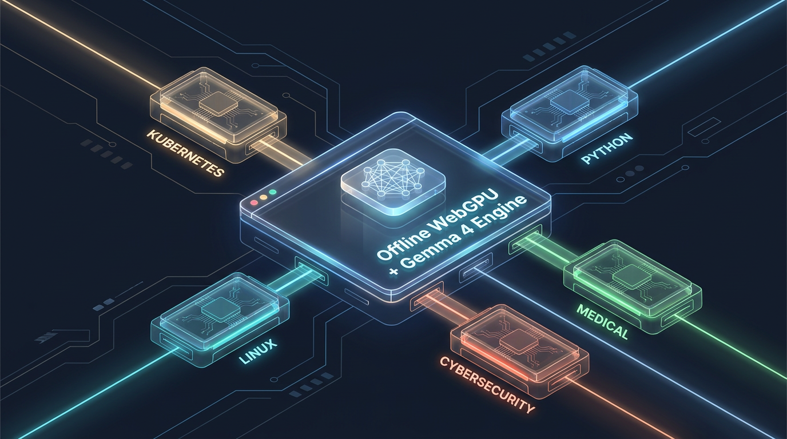
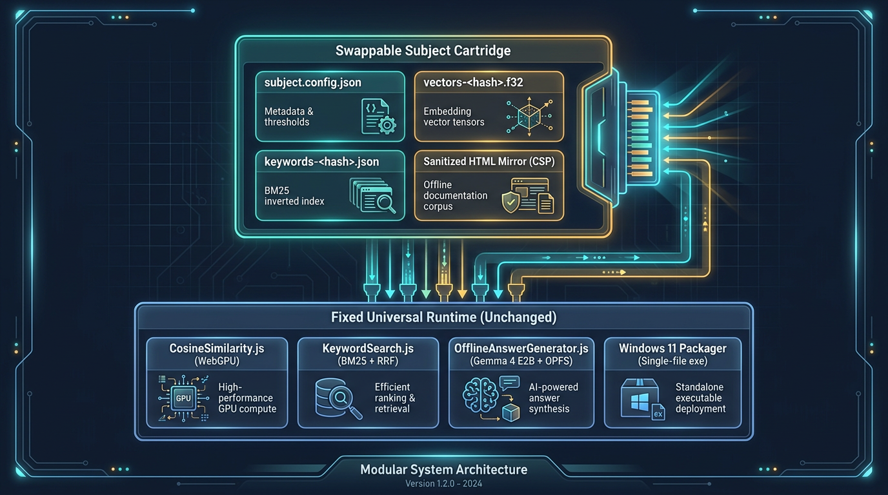
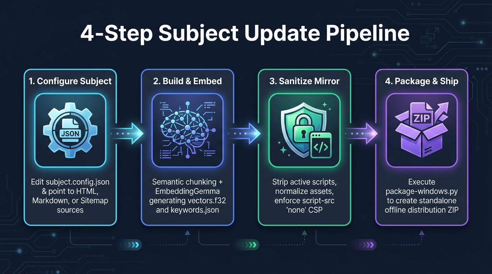

# Making Offline Web AI RAG Universal: How to Swap Subjects in Minutes

### Turn a Kubernetes-specific offline RAG exam assistant into a reusable, subject-agnostic platform for Python, Linux, Cybersecurity, or any technical course.



In the [first article](https://dev.to/gde/leveling-the-playing-field-building-a-100-offline-kubernetes-docs-rag-exam-assistant-with-web-ai-53bi), we built **[Kubernetes WebAI RAG](https://github.com/wongcyrus/kubernetes-webai-rag)**—a 100% offline, browser-based exam assistant powered by **Gemma 4 E2B**, **EmbeddingGemma**, **LiteRT-LM**, **TensorFlow.js**, and **WebGPU**.

That post covered *why* offline Web AI solves classroom equity and academic integrity, and *how* the browser runtime works under the hood (OPFS caching, hybrid BM25 + WebGPU vector search, and Windows 11 zero-config packaging).

Now comes the next practical question from educators:

> **"I don't teach Kubernetes. How do I adapt this for Python, Linux administration, cybersecurity, or my own course notes—and update it easily every semester?"**

The good news is that **the entire browser runtime and Windows packager are already domain-agnostic**. You don't need to touch WebGPU shaders, OPFS caching, or LiteRT-LM bindings to switch subjects.

In this guide, we'll look at how to decouple the **subject corpus** from the **universal runtime**, and how to set up a clean, repeatable workflow to swap or update subjects in minutes.

---

## 1. The Core Insight: Fixed Runtime vs. Swappable Subject Cartridge

When you strip away the Kubernetes branding, the system splits cleanly into two layers:



1. **The Fixed Universal Runtime (Never Changes)**
   - `src/CosineSimilarity.js`: Loads any normalized `vectors-<hash>.f32` matrix into WebGPU.
   - `src/KeywordSearch.js`: Runs BM25 + Reciprocal Rank Fusion (RRF) over any `keywords-<hash>.json`.
   - `src/OfflineAnswerGenerator.js`: Streams grounded answers from `Gemma 4 E2B` with OPFS caching.
   - `scripts/package-windows.py` & `windows/serve.py`: Bundles Python 3.14.4 embeddable + static assets into `<2 GiB` offline ZIPs on `localhost:8080`.

2. **The Swappable Subject Cartridge (Changes Per Course)**
   - **Source Documentation**: An HTML print view, static docs site (MkDocs, Docusaurus, Sphinx), or Markdown/PDFs converted to HTML.
   - **Prebuilt Index**: `vectors-<hash>.f32` + `keywords-<hash>.json` + chunk metadata.
   - **Sanitized Local Mirror**: Offline HTML pages + images with `script-src 'none'` CSP.
   - **Subject Metadata**: Course title, example questions, and the system prompt domain instruction.

---

## 2. Making It Universal with `subject.config.json`

Currently, Kubernetes-specific values live in a few places:
- `scripts/build-kubernetes.mjs` (source URL, sitemap, output paths)
- `src/OfflineAnswerGenerator.js` (`INSTRUCTIONS` mentioning *"Answer Kubernetes questions..."*)
- `web/kubernetes.html` (page title, header, and sample prompt chips)

To make the repo universal for any subject without editing code each time, extract those into a single **`subject.config.json`** at the project root:

```json
{
  "id": "linux-admin",
  "title": "Linux Administration Exam Assistant",
  "source": {
    "type": "html-sitemap",
    "entryUrl": "https://example.edu/linux-docs/_print/",
    "sitemapUrl": "https://example.edu/linux-docs/sitemap.xml"
  },
  "prompt": {
    "domainName": "Linux administration",
    "codeHint": "a practical shell command or config snippet"
  },
  "ui": {
    "placeholder": "Ask about systemd, permissions, networking, or bash...",
    "sampleQuestions": [
      "How do I create and enable a systemd service?",
      "What is the difference between chmod 750 and 640?"
    ]
  }
}
```

With this single config file:
- **Ingestion** reads `source.entryUrl` and `source.sitemapUrl` (or a local `./docs-source/` folder).
- **Generation** interpolates `prompt.domainName` and `prompt.codeHint` into `INSTRUCTIONS` in `OfflineAnswerGenerator.js`—keeping all the anti-injection and citation-grounding rules intact.
- **UI** renders `title`, `ui.placeholder`, and `ui.sampleQuestions` dynamically at startup.

---

## 3. Adapting Any Documentation Format

Not every subject has a single `/_print/` page like Kubernetes. Here is how to feed other common course materials into the same chunker:

- **Static Doc Sites (Sphinx, MkDocs, Docusaurus, MDN)**: Crawl the local build output (`_build/html` or `site/`) or sitemap, then run the same heading-aware chunker (512 max tokens, 64-token overlap).
- **Markdown Course Notes**: Convert `.md` files to clean semantic HTML (using `markdown-it`, which is already bundled in the project) so heading anchors (`#section-id`) work seamlessly in the side-by-side `<iframe>` reader.
- **PDF Textbooks / Lab Manuals**: Extract text by section into HTML pages with heading anchors before running the embedding pipeline.

> **Tip:** Keep heading anchors (`<h2 id="...">`) intact during conversion. That's what lets students click `[1]` in an answer and jump straight to the exact paragraph in the side-by-side reader.

---

## 4. The 4-Step Workflow to Update or Ship a New Subject

Once your `subject.config.json` is in place, updating the assistant for a new subject—or refreshing it for a new semester—takes four straightforward steps:



1. **Configure the Subject**: Update `subject.config.json` with the new course name, sample questions, and documentation source (URL or local folder).
2. **Build & Embed**: Run the ingestion script to chunk by headings, compute 768-dimensional `EmbeddingGemma` vectors, and write `vectors-<hash>.f32` + `keywords-<hash>.json`.
3. **Sanitize the Local Mirror**: Run `scripts/prepare-offline.mjs` to strip scripts/forms/iframes, mirror local images, and apply `script-src 'none'` CSP.
4. **Package & Ship**: Run `scripts/package-windows.py` to generate the `<2 GiB` offline ZIP archives with SHA-256 checksums.

Because **Gemma 4 E2B** (`~2.01 GB`) and **EmbeddingGemma** (`300M`) don't change between subjects, students who already cached the models in their browser's OPFS on `localhost:8080` only need the new lightweight subject bundle!

---

## Conclusion

By separating the **universal WebGPU + Gemma 4 runtime** from the **subject cartridge**, educators can turn a single-course prototype into a repeatable platform for any technical curriculum.

- **One codebase**, unlimited subjects.
- **Zero runtime changes** when updating course materials.
- **Same 100% offline, fair exam experience** for every student.

### Explore the Project
- **GitHub Repository**: [github.com/wongcyrus/kubernetes-webai-rag](https://github.com/wongcyrus/kubernetes-webai-rag)
- **Part 1 (Architecture & Classroom Equity)**: [Leveling the Playing Field: Building a 100% Offline Kubernetes Docs RAG Exam Assistant](https://dev.to/gde/leveling-the-playing-field-building-a-100-offline-kubernetes-docs-rag-exam-assistant-with-web-ai-53bi)

**Suggested Tags:** `WebAI`, `RAG`, `Gemma`, `WebGPU`, `EdTech`
